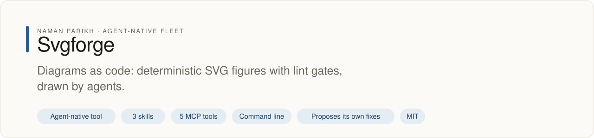
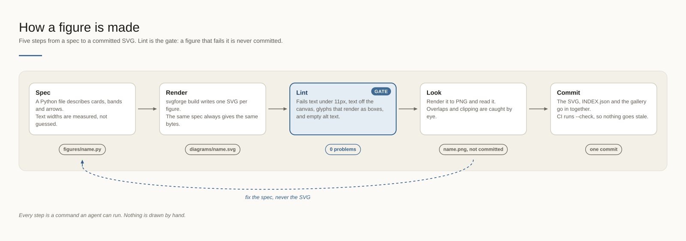
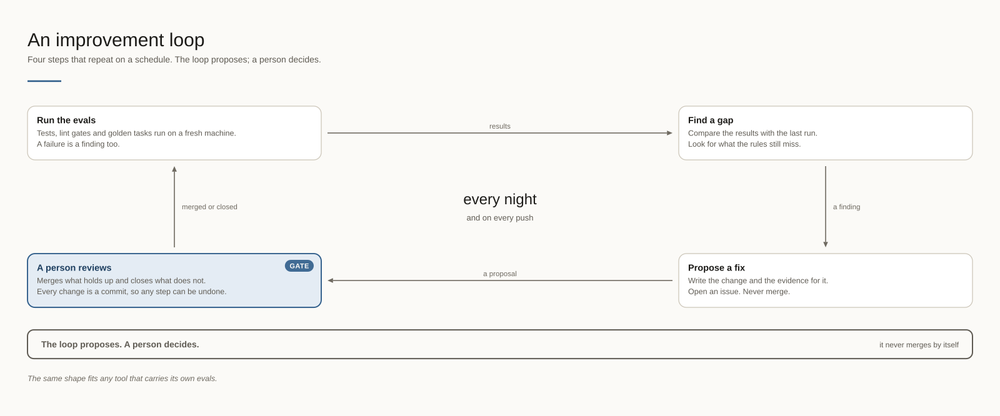
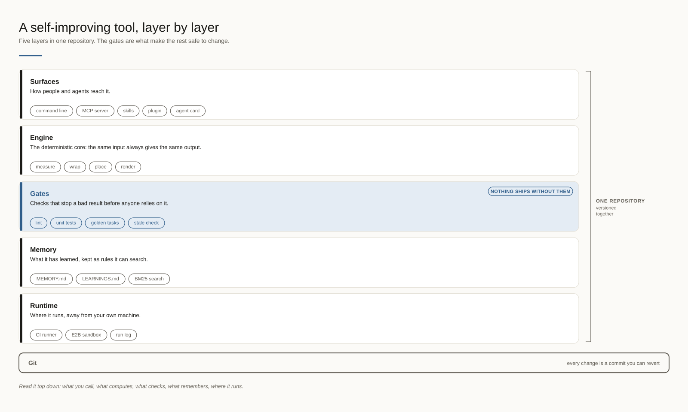

# svgforge

<!-- fleet:header:start -->
<p align="center"><picture><source media="(prefers-color-scheme: dark)" srcset="assets/banner-dark.svg"></picture></p>

<p align="center">
<a href="LICENSE"></a>
<a href="AGENTS.md"></a>
<a href="#use-it-from-any-coding-agent"></a>
<a href="skills/"></a>
<a href="https://x.com/naman10parikh"></a>
<a href="https://www.linkedin.com/in/naman-parikh1/"></a>
</p>

<p align="center"><a href="AGENTS.md">AGENTS.md</a> · <a href="llms.txt">llms.txt</a> · <a href="skills/">Skills</a> · <a href="https://github.com/naman10parikh/svgforge/discussions">Discussions</a> · <a href="SECURITY.md">Security</a> · <a href="CONTRIBUTING.md">Contributing</a> · <a href="https://x.com/naman10parikh">X</a> · <a href="https://github.com/naman10parikh">All projects</a></p>

**Diagrams as code: deterministic SVG figures with lint gates, drawn by agents.**

Svgforge is an agent-native tool: other agents call it through its skills, its MCP server or its command line. A scheduled job runs its evals and proposes fixes. A person makes every change.

_Svgforge is part of an agent-native play for agent-native systems that can eventually be recursively self-improving and evolving, operated by agent employees._
<!-- fleet:header:end -->


Diagrams for documents that agents can draw, read and keep current. You describe a figure in a short Python spec;
svgforge measures and wraps every label, places the cards and arrows, and writes a self-contained SVG with the same
bytes every time. It is for anyone whose docs need diagrams that can be rebuilt in CI and trusted in review.

<!-- fleet:use:start -->
## Use it from any coding agent

**Claude Code**: the plugin brings the skills, sub-agents, hooks and MCP server.

```
/plugin marketplace add naman10parikh/svgforge
/plugin install svgforge@svgforge
```

<details><summary>Its MCP server, Codex, Cursor, Gemini CLI, one skill and the command line</summary>

**Its MCP server**, in any MCP client:

```bash
claude mcp add --transport stdio svgforge -- uvx --from git+https://github.com/naman10parikh/svgforge svgforge-mcp
codex mcp add svgforge -- uvx --from git+https://github.com/naman10parikh/svgforge svgforge-mcp
```

Cursor (`.cursor/mcp.json`), Gemini CLI (`.gemini/settings.json`) and most other clients take the same command as JSON:

```json
{
  "mcpServers": {
    "svgforge": {
      "command": "uvx",
      "args": [
        "--from",
        "git+https://github.com/naman10parikh/svgforge",
        "svgforge-mcp"
      ]
    }
  }
}
```

**Gemini CLI**: the extension brings the context and the MCP server.

```bash
gemini extensions install https://github.com/naman10parikh/svgforge
```

**One skill** (3 in all, in [skills/](skills/)), in any agent that reads Agent Skills:

```bash
gemini skills install https://github.com/naman10parikh/svgforge --path skills/draw-a-figure
git clone --depth 1 https://github.com/naman10parikh/svgforge /tmp/svgforge && cp -r /tmp/svgforge/skills/draw-a-figure ~/.claude/skills/
```

**The command line:**

```bash
uvx --from git+https://github.com/naman10parikh/svgforge svgforge --help
```

</details>

Codex, Cursor, OpenCode, GitHub Copilot and other agents read [AGENTS.md](AGENTS.md); Claude Code reads [CLAUDE.md](CLAUDE.md) and Gemini CLI reads [GEMINI.md](GEMINI.md), which import it. [llms.txt](llms.txt) maps every surface for agents that read first.
<!-- fleet:use:end -->

## Quick start

No clone needed: uv builds svgforge from GitHub on first use.

```bash
uvx --from git+https://github.com/naman10parikh/svgforge svgforge demo --out svgforge-demo
uvx --from git+https://github.com/naman10parikh/svgforge svgforge lint svgforge-demo/*.svg
```

The first command writes the three example figures below, an `INDEX.json` and a `README.md` gallery into
`svgforge-demo/`. The second runs the lint gates on them and prints `OK: 3 file(s) pass the lint gates`.

For your own figures, put specs in `figures/` (AUTHORING.md shows one; `src/svgforge/examples/` has three to copy)
and build them into `diagrams/`:

```bash
svgforge build figures --out diagrams
svgforge build figures --out diagrams --check   # in CI: fails when a committed SVG is stale
```

In a clone, the tests and the evals run with the standard library alone:

```bash
python3 -m unittest && python3 evals/run.py
```

The evals end with `19 passed, 0 failed`.

## Examples

Each of these is rendered from a spec in [`src/svgforge/examples/`](src/svgforge/examples/); the index with their
full descriptions is [`examples/INDEX.json`](examples/INDEX.json).







## How it works

**A figure is a function.** A spec calls the Canvas API. Every text width is measured from a width table, every
line break is computed, and every card is sized to its content. There is no randomness, no clock and no outside
file, so the same spec gives the same bytes, and `svgforge build --check` in CI fails when a committed SVG drifts
from its spec.

**The lint gates.** Every build, and `svgforge lint` on any SVG, checks seven rules: well-formed XML, no text under
11px, at least one text node, no glyph that renders as a box (typed arrows, box-drawing characters), a non-empty
alt text, a canvas taller than 120px, and no text outside the canvas.

**Read, don't look.** Each figure carries an alt text of 80 to 200 words, stored in `INDEX.json` and inside the SVG
(`<desc>` and `aria-label`). `svgforge find`, `svgforge show` and the MCP tools return it, so an agent understands
a figure without rendering it.

**Self-contained output.** No external fonts, images or scripts. A figure renders the same in a browser, on
GitHub, in a notes app and in a model that reads images.

**The hook.** In Claude Code, a hook lints every SVG an agent writes and sends the problems back, so a broken
figure is fixed in the spec before anyone sees it.

**The loop.** Every night a scheduled job runs the evals, reads the figures for glyphs the width table does not
know, and writes proposals to one issue. It never commits; a person makes every change.

**The commands** (each answers `--help`):

```text
svgforge build [figures] [--out diagrams] [--only ID ...] [--check] [--json]   render, lint, index
svgforge lint FILE.svg ... [--json]                                            the lint gates on any SVG
svgforge demo [--out DIR]                                                      the three example figures
svgforge find TERMS ... [--index FILE]                                         search a figure store
svgforge show ID [--index FILE]                                                one figure's record
svgforge route "TASK"                                                          the skill and command for a task
svgforge runs [--last N]                                                       the run log
```

## Limits

- Widths come from a Helvetica table, so a label set in a very different font may run a little wider or narrower;
  every container leaves a margin. A glyph outside ASCII is measured with a fallback width, and the nightly loop
  proposes exact widths for the glyphs your figures use.
- svgforge places what you tell it to. Layout is rows and columns you choose with helpers, not automatic graph
  layout.
- The text-placement rule reads svgforge's own output. On other SVGs, the remaining rules apply.
- The viewer's fonts decide the final look: Instrument Sans where it is installed, else the fallbacks in `T.SANS`.

<!-- fleet:anatomy:start -->
## What it is made of

Every project in this fleet is graded on the same 11 harness components and on self-improvement. Each mark is backed by a file you can open.

| Component | Grade | Where |
| --- | --- | --- |
| Identity | ✅ | identity/SOUL.md:7 + identity/BRAND.md:5 |
| Memory | ✅ | memory/MEMORY.md:1 + scripts/memory_search.py:49 |
| Skills | ✅ | skills/draw-a-figure/SKILL.md:1 |
| Tools/CLIs | ✅ | pyproject.toml:26 + src/svgforge/cli.py:30 |
| Hooks | ✅ | .claude/settings.json:4 + hooks/hooks.json:4 |
| Sub-agents | ✅ | .claude/agents/figure-author.md:1 |
| MCPs | ✅ | src/svgforge/mcp_server.py:31 + pyproject.toml:26 |
| Dispatch | ✅ | src/svgforge/route.py:37 + .github/workflows/loop.yml:5 |
| Evals | ✅ | evals/run.py:1 + .github/workflows/ci.yml:24 |
| Observability | ✅ | src/svgforge/runlog.py:26 |
| Sandbox/Infra | ✅ | sandbox/run_in_sandbox.py:44 |
| Self-improvement | ✅ | dsip.json:1 + .github/workflows/loop.yml:41 |

✅ real and tested · 🟡 partial, with the reason in the row · ❌ absent
<!-- fleet:anatomy:end -->

<!-- fleet:footer:start -->
## How it improves itself

It carries its own evals and a self-improvement contract, [`dsip.json`](dsip.json), which says what it may change and how a change is judged. A scheduled job runs its evals and proposes fixes. A person makes every change. Lessons it learns are kept as rules in its memory files.

## Part of a fleet

One of the projects by [Naman Parikh](https://github.com/naman10parikh). Each owns one part of an agent's harness, or of the product around an agent, and all of them follow one standard.

Siblings: [agentdial](https://github.com/naman10parikh/agentdial) (identity) · [wikimem](https://github.com/naman10parikh/wikimem) (memory) · [skillsmith](https://github.com/naman10parikh/skillsmith) (skills) · [agent-booster](https://github.com/naman10parikh/agent-booster) (tools / CLIs) · [armory](https://github.com/naman10parikh/armory) (MCPs and the component registry) · [agentgrid](https://github.com/naman10parikh/agentgrid) (dispatch) · [agentswarm](https://github.com/naman10parikh/agentswarm) (dispatch) · [agentbench](https://github.com/naman10parikh/agentbench) (evals) · [agentmoney](https://github.com/naman10parikh/agentmoney) (observability) · [claude-harness](https://github.com/naman10parikh/claude-harness) (the whole harness, as a template).

## Community

Questions and ideas go to [Discussions](https://github.com/naman10parikh/svgforge/discussions); bugs go to [issues](https://github.com/naman10parikh/svgforge/issues/new/choose). Follow the work on [X](https://x.com/naman10parikh) and [LinkedIn](https://www.linkedin.com/in/naman-parikh1/).

## Contributing and security

Read [CONTRIBUTING.md](CONTRIBUTING.md). AI-assisted pull requests are welcome. Report a vulnerability privately, as [SECURITY.md](SECURITY.md) explains.

## License

MIT, © 2026 Naman Parikh. See [LICENSE](LICENSE) and [NOTICE](NOTICE).
<!-- fleet:footer:end -->
