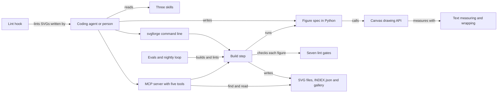

# How Svgforge works

Svgforge draws diagrams for documents from short Python specs. You describe a figure with cards, bands and arrows. Svgforge measures and wraps every label, places each shape, and writes a self-contained SVG with the same bytes every time. Every figure also carries a full text description, so an agent can read it without looking at it. It is for anyone whose docs need diagrams that can be rebuilt in CI and trusted in review.

## The parts



A figure spec is a Python file that exports `FIGURES`, a list of figures with an id, a title and a build function. The build function draws through the `Canvas` in [src/svgforge/canvas.py](../src/svgforge/canvas.py). [src/svgforge/text.py](../src/svgforge/text.py) measures every label from a Helvetica width table and computes each line break, since SVG has no text reflow. [src/svgforge/tokens.py](../src/svgforge/tokens.py) holds the colours and the glyphs that are unsafe in text. [src/svgforge/layout.py](../src/svgforge/layout.py) splits a width into even or weighted columns. [AUTHORING.md](../AUTHORING.md) explains the API and the house rules.

[src/svgforge/build.py](../src/svgforge/build.py) loads the specs, renders them and runs [src/svgforge/lint.py](../src/svgforge/lint.py) on each figure. It then writes the SVGs, an `INDEX.json` and a README gallery. The command line in [src/svgforge/cli.py](../src/svgforge/cli.py) and the MCP server in [src/svgforge/mcp_server.py](../src/svgforge/mcp_server.py) both call it. MCP (Model Context Protocol) is a standard way for an agent to call tools. [src/svgforge/store.py](../src/svgforge/store.py) reads an `INDEX.json` for search. The hook in [hooks/svg_lint_hook.py](../hooks/svg_lint_hook.py) lints every SVG an agent writes.

## What happens when you run it

The main flow is `svgforge build figures --out diagrams`.

1. [src/svgforge/cli.py](../src/svgforge/cli.py) reads the arguments and calls `run`.
2. `load_figures` in [src/svgforge/build.py](../src/svgforge/build.py) imports every `.py` file in the folder, in name order. It skips files whose names start with an underscore, and it fails on a duplicate id.
3. For each figure, `build` calls the spec's build function. The function returns the SVG and its alt text.
4. `lint` checks seven rules: well-formed XML, no text under 11px, at least one text node, and no glyph that renders as a box. It also requires a non-empty alt text, a canvas taller than 120px and no text outside the canvas.
5. `build` writes each SVG only when its bytes changed. Then it writes `INDEX.json` and a `README.md` gallery beside them.
6. With `--check`, it writes nothing and lists every stale file instead. The command exits 1 on any stale file or lint problem.
7. The command prints one line per figure and a count. [src/svgforge/runlog.py](../src/svgforge/runlog.py) appends one JSON line to the run log.

`svgforge demo --out DIR` runs the same steps on the three bundled specs in [src/svgforge/examples/](../src/svgforge/examples/). `svgforge find` and `svgforge show` read an `INDEX.json` and return each figure's description.

## Extending it

- **A figure.** Add a spec to your `figures/` folder, following [AUTHORING.md](../AUTHORING.md) and [src/svgforge/examples/pipeline.py](../src/svgforge/examples/pipeline.py). Build it, render it to an image to look at it, then commit the SVG, `INDEX.json` and the gallery together.
- **A lint rule.** Add it to `RULES` and to `lint` in [src/svgforge/lint.py](../src/svgforge/lint.py). Add a bad fixture to [evals/fixtures/bad/](../evals/fixtures/bad/) and map it to its rule in [evals/golden.json](../evals/golden.json).
- **A command.** Add a subparser in `parser` and a branch in `run` in [src/svgforge/cli.py](../src/svgforge/cli.py). Cover it in [tests/test_surfaces.py](../tests/test_surfaces.py).
- **An MCP tool.** Add it to `TOOLS` and to `call` in [src/svgforge/mcp_server.py](../src/svgforge/mcp_server.py). Update the tool count that [evals/run.py](../evals/run.py) expects.
- **A skill.** Add `skills/<name>/SKILL.md`, following [skills/draw-a-figure/SKILL.md](../skills/draw-a-figure/SKILL.md). Add a route in `ROUTES` in [src/svgforge/route.py](../src/svgforge/route.py) so `svgforge route` can point to it.
- **A glyph width.** Add the glyph to the width table in [src/svgforge/text.py](../src/svgforge/text.py). The nightly loop proposes these.

Then run `python3 -m unittest && python3 evals/run.py`. CI runs both on every push to main and on every pull request.

## Questions

**Does it need an API key or cost money?**
No. Svgforge uses the Python standard library only, and it never calls a model. The one exception is optional. `sandbox/run_in_sandbox.py --boot` runs the evals in an E2B cloud microVM, which needs `E2B_API_KEY` and is a billed call.

**Does any data leave the machine?**
No, for build, lint, find, show and the MCP server. The run log stays on your machine, in `$XDG_STATE_HOME/svgforge/runs.jsonl` by default. Set `SVGFORGE_RUNLOG` to move it, or to `off` to stop it. With `--boot`, the sandbox script sends a `git archive` of the checkout to E2B.

**How does it improve itself?**
Its self-improvement contract, [dsip.json](../dsip.json), names one level, `agent`, a nightly loop and `noSelfGrading: true`. It reads no outside sources. [.github/workflows/loop.yml](../.github/workflows/loop.yml) runs [evals/loop.py](../evals/loop.py) every day at 06:17 UTC. The loop runs the evals and reads the example figures for glyphs the width table does not know. It writes each finding as a proposal. When there is one, it opens or updates a single issue. It never commits, and a person makes every change.

**How do I run its tests or checks?**

```bash
python3 -m unittest                                  # unit and surface tests
python3 evals/run.py                                 # structural checks, golden lint tasks and an MCP round trip
svgforge build figures --out diagrams --check        # in CI: fail when a committed SVG is stale
python3 scripts/memory_search.py "arrows"            # search the project's own notes
```

**What does it not do?**
It does not lay out a graph automatically: you place rows and columns with helpers. It writes SVG only, so a visual check needs another tool to render an image. Widths come from a Helvetica table, so labels in a very different font can run slightly wider or narrower. The text-placement rule reads only Svgforge's own output. On other SVGs, the other rules still apply.
